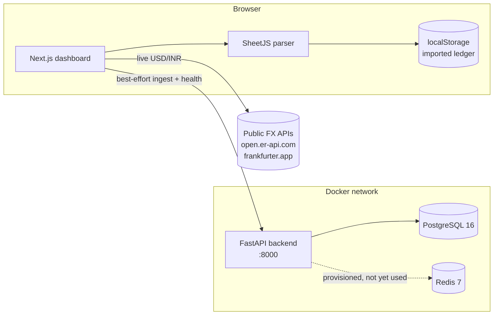

# Syncfolio

**A self-hosted, multi-asset portfolio reconciliation and drift-analysis engine for Indian investors who hold both domestic mutual funds and US equities.**

Syncfolio consolidates holdings that live across different brokers and currencies (Indian mutual funds via CAMS/KFintech, US stocks and ETFs via INDmoney/DriveWealth, trades from Zerodha), normalises them into a single INR-denominated ledger, shows how far your real allocation has drifted from your target, and tells you exactly where fresh capital should go to fix it **without selling anything** (and so without triggering capital-gains tax).

> **Status:** active development. The FastAPI backend is a complete, tested engine. The Next.js dashboard currently runs largely client-side (see [Current limitations](#current-limitations) for an honest account of what is and isn't wired end to end).

---

## Table of contents

- [What problem it solves](#what-problem-it-solves)
- [Features](#features)
- [Architecture](#architecture)
- [Tech stack](#tech-stack)
- [Quick start](#quick-start)
- [Using the dashboard](#using-the-dashboard)
- [Configuration](#configuration)
- [API reference](#api-reference)
- [How the engines work](#how-the-engines-work)
- [Project structure](#project-structure)
- [Testing](#testing)
- [Security and privacy](#security-and-privacy)
- [Current limitations](#current-limitations)
- [Roadmap](#roadmap)

---

## What problem it solves

If you invest through several platforms, no single app shows your true picture:

- Mutual funds sit in **CAMS/KFintech** statements, in **INR**.
- US ETFs and stocks sit in an **INDmoney/DriveWealth** account, in **USD**.
- Other trades sit in **Zerodha**.

Answering *"What am I worth right now, and am I over-exposed to the US?"* means manual spreadsheets and currency maths. Syncfolio does that reconciliation, keeps the USD/INR rate live, and turns the result into a concrete rebalancing action.

## Features

### Dashboard (Next.js)
- **Consolidated net worth** in INR or USD with a one-click toggle and a dual-currency sub-valuation.
- **Live USD/INR rate** (auto-refreshed every 60 s) with caching and multi-source fallback.
- **Asset-allocation donut** (actual weights) and a segmented allocation bar.
- **Drift and tolerance matrix**: target % vs. actual %, drift, and a status badge (`Balanced` / `Underweight` / `Overweight`).
- **Fresh-capital rebalancer**: enter an amount (or use the +10k / +25k / +50k / +100k presets) and see the proportional buy order per asset class.
- **Statement import** for INDmoney / broker spreadsheets (`.xls`, `.xlsx`, `.csv`), parsed in the browser across **all sheets**.
- **Transaction ledger** with category tabs, search, platform and order-type filters, configurable page size, per-row dual-currency values, and **CSV export**.
- **Noise rejection**: legal disclaimers, footers, subtotals and zero-value rows in broker statements are filtered out so only real holdings reach the ledger.

### Backend (FastAPI)
- Normalising **ingestion adapters** for Zerodha, CAMS and DriveWealth payloads.
- **Deduplication** by deterministic content hash, so re-importing a statement never double-counts.
- **Ledger reconciliation** that rebuilds per-account holdings from transactions.
- **FX service** with a dated-rate table, per-process caching and a safe fallback.
- **Target allocations** with validation (must sum to 100 %, no duplicate classes).
- **Real-time drift engine** and **tax-optimised buy-only rebalancing**.
- **Async ingestion jobs** that return `202 Accepted` and can be polled.
- Liveness, readiness and system-info health probes.

## Architecture



**Backend layering:** `routes` (HTTP) → `services` (business logic) → `models` (SQLAlchemy ORM) → PostgreSQL, with Pydantic `schemas` at the API boundary and Alembic for migrations.

## Tech stack

| Layer | Technology |
|---|---|
| Frontend | Next.js 15 (App Router), React 19, TypeScript, Tailwind CSS, Recharts, Lucide icons |
| Spreadsheet parsing | SheetJS (`xlsx` 0.20.3, in-browser) |
| Backend | Python 3.12, FastAPI, Pydantic v2, SQLAlchemy 2 (async), asyncpg, Alembic |
| Data | PostgreSQL 16, Redis 7 |
| Tooling | Docker / Docker Compose (multi-stage, non-root images), pytest + pytest-asyncio |

## Quick start

### Prerequisites
- Docker and Docker Compose (recommended), **or** Python 3.12 + Node 20 + a local PostgreSQL 16.

### 1. Configure environment
```bash
cp .env.example .env
```
Open `.env` and **replace `CHANGE_ME_STRONG_PASSWORD`** (in both `POSTGRES_PASSWORD` and `DATABASE_URL`). Generate a strong value with:
```bash
python -c "import secrets; print(secrets.token_urlsafe(32))"
```
`docker compose` will refuse to start if `POSTGRES_PASSWORD` is unset, by design.

### 2. Start everything
```bash
docker compose up --build
```
| Service | URL |
|---|---|
| Dashboard | http://localhost:3000 |
| API | http://localhost:8000 |
| Interactive API docs | http://localhost:8000/docs |

PostgreSQL (`5432`) and Redis (`6379`) are bound to `127.0.0.1` only.

### 3. Apply database migrations
Migrations are **not** run automatically on startup:
```bash
docker compose exec backend alembic upgrade head
```
Optionally seed the baseline FX reference rates: `POST http://localhost:8000/api/v1/fx/seed`.

### Running without Docker (frontend only)
The dashboard works standalone, because parsing, valuation and drift run in the browser:
```bash
cd frontend
npm install
npm run dev        # http://localhost:3000
```

## Using the dashboard

1. Click **Import Statement** (top-right, or **Add Statement** in the ledger).
2. Drop in your INDmoney / broker spreadsheet (`.xls`, `.xlsx`, `.csv`).
3. Holdings appear in the ledger; net worth, allocation chart and drift matrix recompute immediately.
4. Switch **INR / USD** at the top of the net-worth card.
5. In the drift matrix, enter the cash you plan to invest to see how to split it.
6. Use **Export CSV** to download the ledger. **Reset** (navbar) clears the imported ledger stored in your browser.

**How holdings are classified**

| Asset class | Rule (name/ticker based) |
|---|---|
| Gold & Commodities | contains `GOLD` / `SILVER` |
| Debt & Cash | contains `LIQUID`, `DEBT`, `OVERNIGHT`, `TREPS`, `ARBITRAGE`, `CASH`, `BOND` |
| US Equities & ETFs | USD-denominated instruments (e.g. `VOO`, `Vanguard S&P 500 ETF`) |
| Domestic Equity MF | everything else in INR (ISINs starting `INF`/`INE`, known Indian AMCs) |

The default dashboard targets are **45 % domestic equity MF / 25 % US equity / 15 % gold / 15 % debt & cash**.

## Configuration

All backend settings come from environment variables (`.env`), validated by Pydantic in [`backend/app/core/config.py`](backend/app/core/config.py).

| Variable | Default | Purpose |
|---|---|---|
| `ENVIRONMENT` | `development` | `development` / `staging` / `production`. Controls CORS. |
| `DEBUG` | `True` | Verbose logging and FastAPI debug mode. **Set `False` outside local dev.** |
| `APP_PORT` | `8000` | Host port for the API. |
| `POSTGRES_USER` / `POSTGRES_DB` | `syncfolio_user` / `syncfolio_db` | Database identity. |
| `POSTGRES_PASSWORD` | *(required)* | Database password. No default. |
| `POSTGRES_HOST` / `POSTGRES_PORT` | `postgres` / `5432` | Database location. |
| `DB_POOL_SIZE`, `DB_MAX_OVERFLOW`, `DB_POOL_TIMEOUT`, `DB_POOL_RECYCLE`, `DB_ECHO` | `10`, `20`, `30`, `1800`, `False` | Connection-pool tuning. |
| `REDIS_HOST` / `REDIS_PORT` / `REDIS_URL` | `redis` / `6379` / `redis://redis:6379/0` | Reserved for caching/queueing. |

Frontend: `NEXT_PUBLIC_API_URL` (default `http://localhost:8000/api/v1`) points the dashboard at the API.

## API reference

Base path: `/api/v1`. Full schemas and a try-it console are at `/docs`.

| Area | Method and path | Description |
|---|---|---|
| Health | `GET /health/live`, `/health/ready`, `/health/info` | Liveness, readiness (incl. DB), system info |
| Ingestion | `POST /ingestion/cams` \| `/zerodha` \| `/drivewealth` | Normalise and persist a broker payload (synchronous) |
| Jobs | `POST /jobs/ingest/cams` \| `/zerodha` \| `/drivewealth` | Same ingestion as a background job, returns `202` |
| Jobs | `GET /jobs/{job_id}` | Poll job status (`PENDING` → `PROCESSING` → `COMPLETED` / `FAILED`) |
| Reconciliation | `POST /reconciliation/accounts/{account_id}` | Rebuild holdings for an account from its ledger |
| Holdings | `GET /holdings/accounts/{account_id}` | Current holdings for an account |
| FX | `GET /fx/convert?amount=&from_currency=&to_currency=` | Convert using the latest stored rate |
| FX | `POST /fx/seed` | Seed baseline USD/INR reference rates |
| Portfolio | `POST` / `GET /portfolios/{id}/targets` | Set / read target allocations (must total 100 %) |
| Portfolio | `GET /portfolios/{id}/drift` | Real-time drift vs. target |
| Portfolio | `POST /portfolios/{id}/rebalance` | Rebalance plan (full, or buy-only if cash is supplied) |

## How the engines work

**Ingestion and deduplication.** Each broker payload is mapped into a common transaction shape. A deterministic hash over the identifying fields is stored per transaction, so replaying the same statement is idempotent.

**Reconciliation.** Holdings are not stored independently of the ledger. They are derived by replaying transactions, which keeps units and cost basis auditable.

**FX.** Valuations are normalised to INR. The backend looks up the nearest-prior dated rate in PostgreSQL and falls back to a built-in reference rate if none exists. The dashboard fetches a live rate from public FX APIs (primary → secondary → backend → last cached → built-in fallback).

**Drift.** For each asset class: `drift = actual% − target%`. If `|drift|` exceeds that class's `rebalance_threshold_pct` it is flagged `OVERWEIGHT` or `UNDERWEIGHT`.

**Tax-optimised rebalancing.** With fresh capital, the engine only **buys**. For each class the shortfall against the *post-investment* target value is computed, and the cash is split in proportion to those shortfalls (never exceeding a class's own shortfall). Nothing is sold, so no capital gains are realised.

## Project structure

```
Syncfolio/
├── docker-compose.yml          # postgres, redis, backend, frontend
├── .env.example                # copy to .env and set a strong password
├── backend/
│   ├── main.py                 # app factory, lifespan, CORS, router mount
│   ├── alembic/                # async migrations
│   ├── app/
│   │   ├── api/routes/         # fx, health, holdings, ingestion, jobs, portfolios, reconciliation
│   │   ├── core/               # config.py, database.py
│   │   ├── models/             # SQLAlchemy models + enums
│   │   ├── schemas/            # Pydantic request/response models
│   │   └── services/           # deduplication, drift, fx, ingestion, job, reconciliation
│   └── tests/                  # unit, async-job and end-to-end tests
└── frontend/
    ├── Dockerfile              # multi-stage, standalone output, non-root
    └── src/
        ├── app/                # layout, page (dashboard orchestration), globals.css
        ├── components/         # Navbar, NetWorthCard, AllocationChart, DriftMatrix,
        │                       # IngestionModal, TransactionLedger
        ├── lib/                # api.ts (data + FX), parser.ts (statement parsing), utils.ts
        └── types/              # portfolio.ts (shared TypeScript types)
```

## Testing

Backend tests live in `backend/tests` and cover hash determinism and collision resistance, target-allocation validation, FX fallback integrity, health endpoints, async job flow, and multi-currency end-to-end drift and rebalancing.

```bash
cd backend
pip install -r requirements.txt
pytest                       # DB-backed tests need PostgreSQL reachable per your .env
```

Frontend: `cd frontend && npm run build` type-checks and builds; `npm run lint` runs ESLint.

## Security and privacy

- **Your financial data stays in your browser.** Imported statements are parsed locally and kept in `localStorage`. They are **not** uploaded to any third party. The only outbound calls are public FX-rate lookups (which carry no portfolio data) and optional requests to *your own* backend.
- **No secrets in the repo.** `.env` is git-ignored; only `.env.example` with a placeholder is tracked. Docker Compose refuses to start without `POSTGRES_PASSWORD`.
- **Network exposure.** PostgreSQL and Redis publish to `127.0.0.1` only. Redis has no authentication, so never expose it publicly.
- **CORS** uses an explicit allow-list (the local dashboard origin) in development and denies cross-origin access in other environments.
- **Containers** run as non-root users.
- **Dependencies** are pinned and audited (`npm audit`). `xlsx` is consumed from the maintainer's patched release because the npm registry copy is unmaintained and vulnerable.
- **Before any real deployment:** set `DEBUG=False` and `ENVIRONMENT=production`, use a strong unique database password, put the API behind TLS and authentication, and use a production process manager rather than `--reload`.

Found a vulnerability? Please open a private security advisory on GitHub rather than a public issue.

## Current limitations

Being explicit so nothing is oversold:

- **The dashboard is client-first.** Parsing, valuation and drift on the dashboard are computed in the browser from `localStorage`. The backend ingestion call is fire-and-forget, and the dashboard does **not** yet read portfolio data back from the backend's database or drift endpoints.
- **Clearing browser data clears the ledger.** There is no server-side persistence for dashboard imports yet.
- **CAMS PDF import is not implemented in the browser.** The upload dialog accepts `.pdf` and shows a password field, but there is no PDF parser yet. Use spreadsheet/CSV exports for now.
- **Redis is provisioned but unused.** Background jobs use FastAPI's in-process `BackgroundTasks`, so queued jobs do not survive a restart.
- **No authentication / multi-user support.** The backend has a user model but no auth layer; treat it as single-user and local.
- **Two allocation models.** The backend uses five asset classes (domestic equity, international equity, domestic debt, commodity, cash equivalent); the dashboard uses four. They are not yet unified.
- **Classification is heuristic** (name/ticker based) and may misfile unusual instruments.
- **Returns / XIRR, dividends and corporate actions are not computed.** Values reflect imported amounts, not live market prices.
- **Not financial advice.** Syncfolio is a tracking and arithmetic tool.

## Roadmap

- Wire the dashboard to the backend (read holdings, drift and rebalance from the API) and persist imports server-side.
- CAMS/KFintech CAS PDF parsing with password-protected statement support.
- Redis-backed durable job queue (e.g. ARQ or Celery).
- Authentication and per-user portfolios.
- Live market prices, XIRR and dividend tracking.
- Unified asset-class taxonomy and user-editable targets in the UI.
- CI pipeline (lint, type-check, tests, dependency and secret scanning).
